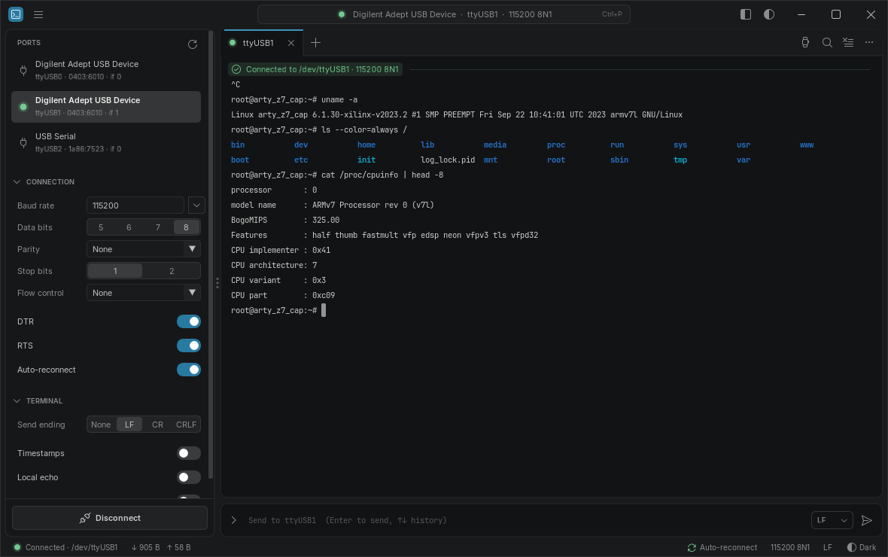

# imserial

A fast, minimal serial terminal with a VS Code–style UI and automatic reconnect.
It's written in C17 on top of Dear ImGui (via cimgui), SDL3 and libserialport.
Linux is the primary target. The code is structured to build on Windows (and
macOS) as well.



## Features

- **Auto-reconnect.** Each session follows its device by USB identity
  (VID:PID, serial number and interface), not by `/dev/ttyUSBn`. When the
  cable is pulled, the session waits. When the device comes back, it reopens
  it, even under a new device path. A device that turns up on the old path but
  isn't the same one is never opened. Every drop and recovery is logged inline
  in the terminal.
- **Tabs.** Each tab is its own session, with its own port, settings,
  scrollback, send history and reconnect state. Tabs and their connections are
  restored at the next launch.
- **Terminal.** An xterm-compatible screen, so full-screen programs such as
  vim, less, nano and htop work: cursor addressing, scroll regions,
  insert/delete, the alternate screen, DEC line drawing, cursor position and
  device-attribute replies, application cursor keys and bracketed paste.
  ANSI colours (16, 256 and truecolor), bold, dim and inverse; lines wrap at
  the window width. Stray control bytes show as visible glyphs, and a bare LF
  starts a new line on the main screen, as embedded devices expect. The
  scrollback keeps 200k lines and only draws the lines on screen.
- **Two ways to type.** Click into the terminal and keystrokes go straight to
  the port (Ctrl+C, arrow keys, Tab completion and so on). Or use the line
  input at the bottom, which has history and a choice of line ending.
- **Mouse selection and copy.** Double-click selects a word and triple-click
  selects a line. **Find** (Ctrl+F) highlights every match. Optional
  millisecond timestamps.
- **VS Code 2026 Dark and Light themes.** Colours come from VS Code's
  `2026-dark.json` and `2026-light.json`. The window has a custom title bar
  with a menu bar and a "command center" port picker, rounded panes, a
  splitter with grip dots, and Codicons.
- **Light on resources.** The app renders only when something changes, so an
  idle window uses essentially no CPU. A 20k-line burst at 115200 baud uses
  about 6% of one core.

## Building

Dependencies are fetched and built automatically: SDL3, cimgui/Dear ImGui and
libserialport. On Linux, FreeType comes from the system (`libfreetype-dev`).
You need CMake 3.24 or newer, Ninja (optional), a C17 compiler, and a C++17
compiler for Dear ImGui itself.

```sh
cmake -S . -B build -G Ninja -DCMAKE_BUILD_TYPE=Release
ninja -C build
./build/imserial
```

On Debian/Ubuntu, SDL3 needs the usual X11/Wayland development headers. See
the [SDL Linux build dependencies](https://wiki.libsdl.org/SDL3/README-linux#build-dependencies).
To open serial ports, your user must be in the `dialout` group.

### Packages

`cpack --config build/CPackConfig.cmake` builds a `.tar.gz`, `.deb` and `.rpm`
on Linux (needs `dpkg-dev` and `rpm`) and a `.zip` on Windows. The GitHub
Actions workflow in `.github/workflows/build.yml` does this for every push
and pull request and uploads the results as artifacts; pushing a `v*` tag
attaches them to a GitHub release.

### Windows

The same CMake project should build with MSVC or MinGW. SDL3 and libserialport
(SetupAPI enumeration plus overlapped I/O) handle the platform details, and
FreeType is fetched when the system doesn't provide it. The serial and UI code
avoid POSIX APIs; the only exception is a SIGTERM handler behind `#ifndef _WIN32`.

## Using it

| Action | Shortcut |
|---|---|
| Pick a port / run a command | Ctrl+Shift+P, or click the command center in the title bar |
| New tab / close tab | Ctrl+Shift+T / Ctrl+Shift+W (middle-click a tab to close it) |
| Next / previous tab | Ctrl+Tab / Ctrl+Shift+Tab, Alt+1…9 |
| Connect / disconnect | F5 / Shift+F5, or the button at the bottom of the sidebar |
| Toggle sidebar | Ctrl+Shift+B |
| Find | Ctrl+Shift+F (Enter / Shift+Enter step through matches) |
| Copy / paste (terminal) | Ctrl+Shift+C / Ctrl+Shift+V. Ctrl+C copies when text is selected; otherwise it sends ^C |
| Clear terminal | Ctrl+Shift+K |
| Terminal font size | Ctrl+= / Ctrl+- / Ctrl+0 |
| Preferences | Ctrl+, |
| Quit | Ctrl+Shift+Q |

While the terminal has keyboard focus and is connected, every Ctrl+letter goes
to the device (vim and shells use them all), so the app's shortcuts are on
Ctrl+Shift+letter. Outside the terminal, the plain Ctrl forms work too.

Serial has no way to tell the device the window size. The status bar shows the
terminal's columns × rows; click it (or use **Connection > Send Terminal
Size**) to send `stty rows R cols C` to the device's shell. Set `TERM=xterm-256color`
on the device for full-screen programs.

In the sidebar, double-click a port to connect to it. If the current tab is
already busy with another port, the double-click opens it in a new tab
instead. Changes to baud rate, framing, flow control and DTR/RTS take effect
immediately on a live connection.

**File > Preferences** sets the theme, zoom, UI font size, terminal font (the
built-in IBM Plex Mono or JetBrains Mono, any monospace font installed on the
machine, or any TTF/OTF file) and terminal font size. Its
Console section chooses whether the console fits the window or has a fixed
size in columns × rows (like PuTTY's window size, handy for matching the
device's tty), and how many lines of scrollback to keep.

**Session logging** (Preferences > Logging) works like PuTTY's: *Printable
output* writes the text with escape sequences and control codes stripped (plus
connection events, and optionally a timestamp per line); *All output* writes
the exact bytes received. The log file name takes `&Y &M &D` (date), `&T`
(time) and `&P` (port), defaulting to
`Documents/imserial logs/imserial-&P-&Y&M&D-&T.log`. If the file already
exists, imserial overwrites it, appends to it or asks (the default). Each tab
logs one connection, automatic reconnects included, to its own file; a red
"Log" item in the status bar shows it's active.

Settings live in `~/.config/imserial/settings.json` (`%APPDATA%\imserial` on
Windows).

## Architecture

```
src/
  main.c            SDL/GL setup, custom title-bar hit testing, event-driven frame loop
  app/              tabs, settings persistence (cJSON)
  serial/serial.h   small portable serial API
  serial/serial_sp.c  …implemented on libserialport: wakeable waits, hangup
                      detection, stable port identities
  serial/session.c  one I/O thread per tab and the reconnect state machine
  term/termbuf.c    scrollback ring and VT parser
  ui/               theme, widgets, title bar, sidebar, tabs, terminal view,
                    send bar, status bar, quick pick
tests/              termbuf unit tests, reconnect tests against a fake backend,
                    and a hardware smoke test (test_session)
```

**Data flow.** Each session's I/O thread writes records (RX data, TX data and
state changes, all timestamped) into an inbox. It wakes the UI with a single
SDL user event. Once per frame, the UI swaps the inbox out and feeds it into
the tab's `TermBuf`.

**Keyboard input.** While the terminal has focus, raw keystrokes are taken
directly from SDL events. This bypasses ImGui's input queue, which processes
one event per frame, so fast typing and paste never lag.

**Frame pacing.** The app paces frames itself at the display's refresh rate
instead of relying on vsync. Some drivers block a vsync'd swap for up to a
second, for example NVIDIA on X11 when no monitor is connected.

## Tests

```sh
ctest --test-dir build --output-on-failure
./build/test_session                    # list ports with their stable IDs
./build/test_session /dev/ttyUSB1 115200 30   # watch a live port; unplug/replug to see reconnects
```

## Known issues

- GNOME Shell / Mutter 46 on X11 aborts if a window asks to be maximized while
  no monitor is connected (for example, a DisplayPort monitor that's asleep).
  imserial won't maximize when SDL reports no usable display, but it can't
  detect every variant of that state.
- Not implemented yet: hex view, logging to file, macros, and full-screen VT
  cursor addressing (vim/htop over serial). That last one is deliberate: this
  is a line-oriented serial terminal.

## Licenses

imserial is released under the [MIT License](LICENSE). It bundles the
following:

- [Dear ImGui](https://github.com/ocornut/imgui) and [cimgui](https://github.com/cimgui/cimgui) (MIT)
- [SDL3](https://libsdl.org) (zlib)
- [libserialport](https://sigrok.org/wiki/Libserialport) (**LGPL-3.0-or-later**).
  It's linked statically. The LGPL requires that users can relink the app
  against a modified libserialport; imserial's full source is published and
  the build fetches libserialport from source, so that's satisfied. If you
  ship a closed-source fork, you must provide object files or source so that
  relinking stays possible, or link libserialport dynamically.
- [FreeType](https://freetype.org) (FTL)
- [cJSON](https://github.com/DaveGamble/cJSON) (MIT)
- [Inter](https://rsms.me/inter/), [IBM Plex Mono](https://github.com/IBM/plex) and
  [JetBrains Mono](https://www.jetbrains.com/lp/mono/) (SIL OFL 1.1)
- [Codicons](https://github.com/microsoft/vscode-codicons) (CC BY 4.0)

The license files for the fonts are in `assets/fonts/`.
